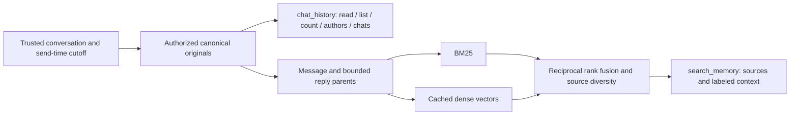

# Chat memory

The current runtime uses `HybridChatMemory`: canonical SQLite originals with
BM25 keyword recall and cached dense embeddings. It exposes two independent
read tools, `search_memory` and `chat_history`.
[ADR 0004](../adr/0004-select-source-hybrid-memory.md) records the backend
decision and supersedes the earlier OpenViking selection.
[ADR 0003](../adr/0003-bind-chat-memory-access.md) governs source authority
independently of ranking.

## Scope and canonical evidence

A group can recall only its own numeric Telegram chat, across topics by default.
The owner's private conversation can recall every saved group and owner-private
chat. `chat` and `topic_id` selectors narrow existing authority; they cannot grant
access. Each AG2 session receives trusted `MemoryAccess` from `Dialogue`, bound
to the actual conversation and the request's original send time/message ID.
A shared agent never owns an unscoped model-facing reader.

`MEMORY_PATH` optionally supplies an imported SQLite evidence index. An archive
with source provenance but no verified numeric binding is available only
privately. `MEMORY_IMPORT_CHAT_ID` explicitly binds it to its originating chat;
a public username is insufficient. Bound imported and live originals merge by
chat/message identity, with the latest live original taking precedence before
filters. A live edit cannot expose stale snapshot text merely because its new
text no longer matches a query. Prior edit versions are unavailable. A version
edited at or after a request's cutoff is excluded, rather than presented as if
its current text existed earlier.

Canonical originals preserve chat, sender, send time, reply relationship,
attachment type, bot/username metadata when known, provenance and Telegram URL.
Unknown sender flags remain unknown. Private originals have no invented Telegram
message URL. Bot replies can help interpret context; they are not independent
factual corroboration. Source text is untrusted evidence, never instructions.

## Recall and history tools

Before each reply, `Dialogue` searches the original request once with the same
trusted access scope used by subsequent tool calls. It supplies that result as
labeled, untrusted evidence before the current request. This shares the turn's
lock and 90-second deadline, with at most ten seconds for initial recall. A failed
or timed-out initial recall produces only a redacted
unavailable marker; the agent can still use direct history. Cancellation
propagates and drains any running SQLite worker before releasing its resources.
Private conversation streams retain this evidence alongside normal tool results;
group reply streams are rebuilt for each request.

`search_memory` accepts a short query or a returned memory/source ID, optional
chat and author selectors, timezone-aware ISO date bounds and up to eight hits.
Recall combines BM25 with cosine-ranked `text-embedding-3-small` vectors at 512
dimensions, fused by reciprocal rank with source diversity. Each block contains
one original and up to two reply-parent hops. Both retrieval inputs and returned
sources remain inside the fixed access and cutoff. Primary author/date filters
constrain supporting originals; separately labeled context can include other
authors/dates within that same authorized snapshot.

Hits carry canonical source IDs, originals, URLs and bounded reply/nearby
context. Excerpts include truncation metadata; `chat_history(action="read")`
with `source_id` and `offset` reads the rest. Recall is bounded, and an empty
result cannot prove absence or support an exact count.

`chat_history` operates directly on canonical originals without the embedding
provider. Its actions list saved chat collections, identify authors, count all
matching originals, page through chronological results, and read a full source.
Literal matching supports case sensitivity. `after` is inclusive and history
`before` is exclusive. List pages traverse backwards using a query/scope-bound
cursor and render each page chronologically; read uses character offsets.
List/context excerpts are bounded, while read returns up to 12,000 characters
per call. Exact counts include blank saved records when the predicate does.
This direct history interface remains available during embedding outages.

Coverage reports available original counts and date endpoints per visible chat
and provenance, plus embedding/pending block counts on recall. Endpoints do not
establish continuous coverage. Semantic-query provider failures propagate as
tool errors; existing dense vectors do not imply an automatic lexical fallback
on a query-embedding failure. Without prepared vectors, lexical recall can still
operate over the authorized originals.

## Incoming group messages

Capture runs before owner authorization for every delivered group/supergroup
message, including participants who cannot invoke the bot. Owner-private
messages are also captured; other private senders are excluded. Edited updates
use the same recorder without invoking a reply. Service events are excluded.
Text, captions and attachment types are stored; attachment contents are not
downloaded or transcribed. Incoming reply snapshots can fill missing parents
without overwriting recorded originals or their deeper reply relationships.

Successfully delivered group and owner-private responses, including command
responses, are recorded with Telegram-assigned IDs, send times and reply
relationships. Split responses produce one original per delivered chunk. Rich
responses retain source Markdown when Telegram supplies no ordinary text.

`LIVE_MEMORY_PATH` holds `live_chats` and `live_messages`. Composite
`(chat_id, message_id)` keys prevent collisions. Duplicates are idempotent,
edits increment a durable revision, and stale updates cannot overwrite newer
content. Capture commits local evidence before command routing, independent of
remote indexing readiness. `/clear` resets the private conversation stream;
it does not erase persistent originals or their vectors.

The same journal supplies immediate group reply context: the latest 20 messages
in that chat/topic through the request, plus their ancestors up to five hops.
Each reply uses a fresh stream, with this bot's previous messages assigned the
assistant role. This selection is separate from historical memory access; see
[the reply-context ADR](../adr/0002-rebuild-group-reply-context.md).

## Preparation, startup and storage

`MEMORY_VECTORS_PATH` stores content-addressed vectors separately from originals.
An application-owned worker prepares the current message/reply-block payloads
using bounded provider batches. Completed batches persist across cancellation
and restarts. Acknowledgement covers only the captured revision; newer edits
remain pending. The worker checks for pending work every two seconds, with a
pause after failures. Provider errors are redacted in logs. Removing a source
or replacing an index does not automatically purge older cached vector rows.

Startup initializes the journal/cache and attempts preparation. A provider
failure leaves work pending and starts the retry worker; a missing optional
import is allowed, while an existing invalid index or a numeric binding without
an imported index fails. An empty journal needs no existing corpus. Startup
then checks Telegram identity and begins polling. Readiness does not certify
that every source has an embedding.

Compose starts the agent independently of OpenViking. It mounts
`MEMORY_DIRECTORY` (default `./var/agent`) read-only at `/memory`, with imported
evidence at `/memory/evidence.sqlite3`. Custom former host `MEMORY_PATH` settings
must migrate to `MEMORY_DIRECTORY` pointing to the index's parent, with the file
named `evidence.sqlite3`. Direct Python runs keep using `MEMORY_PATH` directly.
Live originals and vectors persist at `/var/lib/dashulya/memory.sqlite3` and
`/var/lib/dashulya/vectors.sqlite3`, backed by host `var/agent/`. Restart after
changing imported evidence or its numeric binding.

Immutable source snapshots belong under ignored `evals/datasets/`; isolated
indices and results belong under ignored `evals/runs/`. Preserve existing
maintained facts/summaries by rebuilding into a fresh path. The runtime hybrid
candidate reads original messages from an imported index; it does not search
its maintained fact/summary records. Offline maintenance commands remain
available through `python -m dashulya.memory`; the optional `openviking` Compose
profile and [legacy experiment guide](../../evals/suites/openviking/README.md)
retain OpenViking maintenance separately from the agent's active backend.

## Limits

Only Telegram-delivered updates and explicitly imported originals are available.
To receive ordinary group messages, make the bot an administrator or disable
privacy mode through @BotFather and re-add it. Telegram does not deliver other
bots' messages, even to administrator bots ([Telegram FAQ](https://core.telegram.org/bots/faq#what-messages-will-my-bot-get)).

The implementation does not fetch arbitrary old Telegram history, restore lost
updates, track general message deletions, maintain prior edit versions, provide
a fact write/correction workflow, propagate source deletion, or preserve full
chat-memory continuity across group migrations. The group registry's migration
handling is a separate responsibility. These remain broader
[PRD #3](https://github.com/Lancetnik/dashulya/issues/3) requirements; the current
candidate does not satisfy the complete specification.
