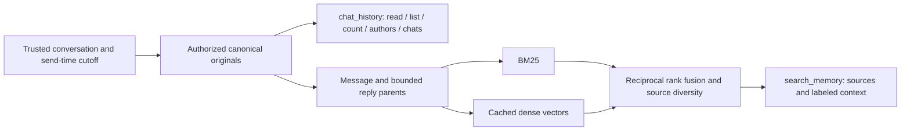

# Chat memory

The current runtime uses `HybridChatMemory`: canonical PostgreSQL originals with
BM25 keyword recall and cached dense embeddings. It exposes two independent
read tools, `search_memory` and `chat_history`.
[ADR 0005](../adr/0005-unify-memory-in-postgresql.md) records unified storage and
native SQL ranking, preserving the hybrid pipeline from ADR 0004.
[ADR 0003](../adr/0003-bind-chat-memory-access.md) governs source authority
independently of ranking.



## Scope and canonical evidence

A group can recall only its own numeric Telegram chat, across topics by default.
The owner's private conversation can recall every saved group and owner-private
chat. `chat` and `topic_id` selectors narrow existing authority; they cannot grant
access. Each AG2 session receives trusted `MemoryAccess` from `Dialogue`, bound
to the actual conversation and the request's original send time/message ID.
A shared agent never owns an unscoped model-facing reader.

Imported and received originals share the `messages` table, keyed by collection
and message ID. Numeric Telegram chat IDs determine bound collections. An archive
without a verified numeric binding is available only privately; the offline
importer's `--chat-id` supplies a verified binding. A public username is
insufficient. Live originals replace imported versions by chat/message identity
before query filters run. A live edit cannot expose stale snapshot text merely because its new
text no longer matches a query. Prior edit versions are unavailable. A version
edited at or after a request's cutoff is excluded, rather than presented as if
its current text existed earlier.

Canonical originals preserve chat, sender, send time, reply relationship,
attachment type, bot/username metadata when known, provenance and Telegram URL.
Unknown sender flags remain unknown. Private originals have no invented Telegram
message URL. Bot replies can help interpret context; they are not independent
factual corroboration. Source text is untrusted evidence, never instructions.

## Recall and history tools

Before each reply, `Dialogue` searches the original request once with the same
trusted access scope used by subsequent tool calls. It supplies that result as
labeled, untrusted evidence before the current request. This shares the turn's
lock and 90-second deadline, with at most ten seconds for initial recall. A failed
or timed-out initial recall produces only a redacted
unavailable marker; the agent can still use direct history. Cancellation
propagates through asynchronous SQL and returns borrowed connections to the pool.
Private conversation streams retain this evidence alongside normal tool results;
group reply streams are rebuilt for each request.

`search_memory` accepts a short query or a returned memory/source ID, optional
chat and author selectors, timezone-aware ISO date bounds and up to eight hits.
Recall combines BM25 with cosine-ranked `text-embedding-3-small` vectors at 512
dimensions, fused by reciprocal rank with source diversity. Each block contains
one original and up to two reply-parent hops. Both retrieval inputs and returned
sources remain inside the fixed access and cutoff. Primary author/date filters
constrain supporting originals; separately labeled context can include other
authors/dates within that same authorized snapshot.

Hits carry canonical source IDs, originals, URLs and bounded reply/nearby
context. Excerpts include truncation metadata; `chat_history(action="read")`
with `source_id` and `offset` reads the rest. Recall is bounded, and an empty
result cannot prove absence or support an exact count.

`chat_history` operates directly on canonical originals without the embedding
provider. Its actions list saved chat collections, identify authors, count all
matching originals, page through chronological results, and read a full source.
Literal matching supports case sensitivity. `after` is inclusive and history
`before` is exclusive. List pages traverse backwards using a query/scope-bound
cursor and render each page chronologically; read uses character offsets.
List/context excerpts are bounded, while read returns up to 12,000 characters
per call. Exact counts include blank saved records when the predicate does.
This direct history interface remains available during embedding outages.

Coverage reports available original counts and date endpoints per visible chat
and provenance, plus embedding/pending block counts on recall. Endpoints do not
establish continuous coverage. Semantic-query provider failures propagate as
tool errors; existing dense vectors do not imply an automatic lexical fallback
on a query-embedding failure. Without prepared vectors, lexical recall can still
operate over the authorized originals.

## Incoming group messages

Capture runs before owner authorization for every delivered group/supergroup
message, including participants who cannot invoke the bot. Owner-private
messages are also captured; other private senders are excluded. Edited updates
use the same recorder without invoking a reply. Service events are excluded.
Text, captions and attachment types are stored; attachment contents are not
downloaded or transcribed. Incoming reply snapshots can fill missing parents
without overwriting recorded originals or their deeper reply relationships.

Successfully delivered group and owner-private responses, including command
responses, are recorded with Telegram-assigned IDs, send times and reply
relationships. Split responses produce one original per delivered chunk. Rich
responses retain source Markdown when Telegram supplies no ordinary text.

PostgreSQL holds canonical `messages` and their collection metadata. Composite
`(collection, message_id)` keys prevent collisions. Duplicates are idempotent,
edits increment a durable revision, and stale updates cannot overwrite newer
content. Capture commits local evidence before command routing, independent of
remote indexing readiness. `/clear` resets the private conversation stream;
it does not erase persistent originals or their vectors.

The same canonical table, including imported originals, supplies immediate group
reply context: the latest 20 messages in the whole ordinary group through the
request, plus their ancestors up to five hops. A real forum topic narrows both
seeds and parents to that topic. Ordinary reply threads never split this window;
old rows with raw thread IDs remain eligible without rewriting originals.
The Telegram adapter shares one `conversation_key()` between capture, addressing
and reply serialization; topic selection uses `is_topic_message`, with a forum's
General topic normalized to 1 when no explicit thread ID is available.
Each reply uses a fresh stream, with this bot's previous messages assigned the
assistant role. This selection is separate from historical memory access; see
[the reply-context ADR](../adr/0002-rebuild-group-reply-context.md).

`ai/group_context.py` formats both reply and addressing context. One shared users
roster uses `id: name (@username, bot, self)`, omitting unavailable values.
Local day and UTC-offset headings apply to JSON-array message rows. The shared
header declares `[id,sender,time,text,reply_to?,attachment?]` once; absent trailing
fields are omitted, with null preserving a missing field before a later value.
JSON encoding preserves escapes and multiline content without creating rows.
Unknown handles are omitted; unknown
numeric senders receive separate local references. The roster is an extra
metadata input, while each original retains its user/assistant API role and
only original message IDs can become reply targets.

`MessageStore.context()` returns `ReplyContext`: bounded messages plus
`truncated_threads` navigation metadata. For depth-cut boundaries, the SQL reader
continues through IDs/reply links only and resolves a root within the selected
chat/topic. The formatter adds one header map from boundary ID to `root_id` and
an optional `source_id`; the agent can read a known root through `chat_history`.
Unresolved roots stay null, and references outside the window cannot become
Telegram reply targets. Source messages and the 20-plus-five-hop selection remain
unchanged. Roots describe saved relationships, not exhaustive live Telegram history.

## Preparation, startup and storage

`DATABASE_URL` selects one PostgreSQL database. `Database` owns one asynchronous
connection pool, shared by message capture, group tracking, original reads,
lexical search and pgvector. Original-message writes commit before routing;
indexing is independent. `embeddings` stores normalized `vector(512)` values
under the existing content key, including model, dimensions and bounded payload.
Native exact inner-product SQL ranks only allowed block keys, with stable ties.
No ANN index is used: all authorized candidates participate before `LIMIT`.

`lexical_documents` and `lexical_terms` store content-addressed block lengths
and term frequencies. SQL computes BM25 prefix matching with corpus statistics
over the authorized snapshot, then applies optional candidate filters. Unicode
6.1 category/folding tables preserve the former FTS5 tokenization. RRF and source
diversity operate on the bounded candidate rankings in Python; vectors are never
loaded for a Python scan. Metadata/block construction runs off the event loop.

An application-owned worker prepares current message/reply-block payloads using
bounded provider batches. Completed batches persist across cancellation and
restarts. Acknowledgement covers only the captured revision; newer edits remain
pending. The worker checks pending work every two seconds and pauses after
failures. Provider errors are redacted. Old content-addressed postings/vectors
can remain cached but do not participate without authorized current block keys.

Startup initializes the schema and attempts preparation. A provider failure
leaves work pending and starts the retry worker. An empty database requires no
import. PostgreSQL must be reachable; startup then verifies Telegram identity
and begins polling. Readiness does not certify complete embedding coverage.
Compose persists PostgreSQL under host `var/postgres/`, without a published
port. `POSTGRES_PASSWORD` configures its internal credentials. Original history,
reply context and search all use that database. In-memory private conversation
streams remain separate and ephemeral.

## SQLite migration

Preserve source files and stop the old agent for the final pass so no updates
arrive between the snapshot and cutover. Use consistent SQLite backups when
copying an active journal. Build the new image and start PostgreSQL first:

```sh
docker compose build agent
docker compose up -d --wait postgres
docker compose run --rm --no-deps \
  -v "$(pwd)/var/agent:/legacy:ro" agent \
  python -m dashulya.memory migrate \
  --evidence /legacy/evidence.sqlite3 --live /legacy/memory.sqlite3 \
  --groups /legacy/dashulya.sqlite3 --vectors /legacy/vectors.sqlite3 \
  --chat-id VERIFIED_NUMERIC_CHAT_ID --owner-user-id OWNER_NUMERIC_USER_ID
```

Each source flag is optional; omit unavailable inputs. Omit `--chat-id` to keep
an archive private-only. Binding an already bound archive to a different chat
is rejected. Binding a previously unbound archive adopts its existing records.
The command opens SQLite read-only and never calls an embedding provider.
It copies all available original metadata, preserves legacy fact/summary bodies
and source IDs in `legacy_records`, and verifies each resulting canonical message
against the source. Repeating the command is idempotent; newer live versions
win. A source digest and counts are returned without message bodies or secrets.

After verification, start the agent with `docker compose up -d --wait agent`.
Its normal worker reuses cached embeddings and prepares only missing/current
payloads. Preserve SQLite files and the old configuration until the deployment
is accepted. A rollback after new PostgreSQL writes needs those new originals
transferred as well; switching containers alone would lose their visibility.
Use `pg_dump` for live PostgreSQL backups, or stop PostgreSQL before copying its
data directory.

Immutable source snapshots stay under ignored `evals/datasets/`; isolated
indices/results stay under `evals/runs/`. Offline SQLite/OpenViking maintenance
commands remain available through `python -m dashulya.memory` and the
[legacy experiment guide](../../evals/suites/openviking/README.md). Neither
legacy engine is in the application's runtime dependency graph.

## Limits

Only Telegram-delivered updates and explicitly imported originals are available.
To receive ordinary group messages, make the bot an administrator or disable
privacy mode through @BotFather and re-add it. Telegram does not deliver other
bots' messages, even to administrator bots ([Telegram FAQ](https://core.telegram.org/bots/faq#what-messages-will-my-bot-get)).

The implementation does not fetch arbitrary old Telegram history, restore lost
updates, track general message deletions, maintain prior edit versions, provide
a fact write/correction workflow, propagate source deletion, or preserve full
chat-memory continuity across group migrations. The group registry's migration
handling is a separate responsibility. These remain broader
[PRD #3](https://github.com/Lancetnik/dashulya/issues/3) requirements; the current
candidate does not satisfy the complete specification.
