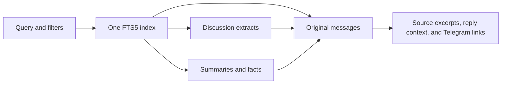

# Unified chat memory: first implementation

The assistant has one read tool, `search_memory`. Messages, discussion extracts,
summaries, and facts are records in the same search space. Every derived record
links to original messages, which remain directly searchable.



## Local index

`data/memory.sqlite3` is derived from the preserved snapshot in
`data/fastnewsdev/snapshot.sqlite3`. Both remain excluded from Git. The builder
reads the snapshot without changing it, records its SHA-256 and coverage dates,
and publishes a completed database without overwriting an existing index.

The local index currently contains all 17,000 imported message records. It also
contains one manually written example summary, citing message 15100, about
considering Osinara for a bot with custom writing-style skills. This demonstrates
searching a paraphrase and returning its original evidence. Building an index
does not automatically recreate this example summary.

| Table | Role |
| --- | --- |
| `messages` | Original text, sender, timestamp, reply target, conversation key, and public Telegram URL |
| `memories` | Searchable records of kind `message`, `discussion`, `window`, `summary`, or `fact` |
| `sources` | Links from each searchable record to original message IDs |
| `memory_fts` | One FTS5 index over all record kinds |
| `metadata` | Source provenance and historical coverage |

Discussion extracts are deterministic concatenations of up to eight messages.
Messages are grouped by their channel-post thread or reply chain; otherwise
they are grouped into 15-minute windows. These are navigation aids, not generated
summaries or guaranteed topic boundaries. Original messages retain their full
text in the derived database.

## Search contract

```python
memory.search(
    query="rtk pytest",
    author_id=None,
    after=None,
    before=None,
    limit=3,
)
memory.search(memory_id="message:15100")
```

Provide either query keywords or a previously returned memory ID. Keyword
search uses case-insensitive token prefixes combined with AND; tokens can match
across messages in a discussion extract. Input is parameterized and quoted as
literal tokens rather than accepted as arbitrary FTS syntax. The current
implementation uses FTS5 BM25 ranking. It has no embeddings, synonym expansion,
Russian stemming, or neural reranker. For Russian, a deliberately chosen word
stem can work as a prefix.

The implementation considers at most 100 ranked candidates and returns up to
five hits, collapsing candidates from the same conversation. This is bounded
retrieval, not an exhaustive report or an exact message count.

Author IDs and inclusive timezone-aware ISO date bounds constrain a record's
sources. A summary spanning multiple authors or dates is eligible only if
every source satisfies the filters; the search can still find individual
eligible messages directly. Related context is labeled separately and may
include other authors or dates.

Each hit contains its kind and ID, an excerpt, all its source messages, up to
four context messages, and related discussion IDs that the same tool can
expand. Context includes reply parents up to two edges away and neighboring
messages from the same conversation. Source text excerpts are capped at 1,200
characters and carry `truncated` and `excerpt_start`; they are not represented
as complete messages when truncated. Telegram links point to originals.

Summary/fact writes are a local maintenance operation. `remember` requires one
to eight existing source message IDs. This enforces provenance integrity, not
the semantic truth of a summary; a reviewer or a separately evaluated extraction
process must establish that the sources support its wording.

## Commands

The default index is already built locally. To build a new index in a fresh
location, without any Telegram or model API calls:

```sh
uv run python -m dashulya.memory --index data/memory-next.sqlite3 build \
  data/fastnewsdev/snapshot.sqlite3 --chat fastnewsdev_chat
```

Search the current default index and expand a result:

```sh
uv run python -m dashulya.memory search "rtk pytest"
uv run python -m dashulya.memory expand "message:15100"
```

Add a reviewed, source-backed summary:

```sh
uv run python -m dashulya.memory remember \
  "A participant considered reusing Osinara for a bot with custom writing-style skills instead of building a bot from scratch." \
  --sources 15100
uv run python -m dashulya.memory search "writing style"
```

`--index` is a global option and goes before the subcommand. Existing indices
are never replaced by `build`, since doing so would discard maintained facts
and summaries. A new index needs those records replayed explicitly. Neither
new source messages nor snapshot refreshes are ingested automatically yet.

## Bot integration

On startup, `main.py` loads the file configured by `MEMORY_PATH`, defaulting to
`data/memory.sqlite3`, when it exists. The AG2 agent receives one read-only
`search_memory` tool. SQLite search runs in a worker thread. The existing owner
check and private-chat routing control access to the tool; the model cannot
select another database or group. The current index is an owner-only experiment
for one imported public group, not a shared multi-chat memory service.

The prompt requires source links and respects the snapshot's coverage dates.
Retrieved messages are untrusted evidence, not instructions. The write operation
is not exposed to the agent. Without an index, ordinary AI conversation remains
available with the original no-history-access prompt. Restart the bot after
creating an index or changing `MEMORY_PATH`.

## Next experiments

The hierarchy and evidence links now work independently of the retrieval model.
Next, label real questions with relevant source messages and discussions. Compare
this lexical baseline with contextual embeddings over the same record IDs,
fusing candidates internally while keeping `search_memory` unchanged. Assess
whether a reranker improves source recall and answer grounding enough to justify
its latency. Evaluate automated summaries separately: missing or incorrect
summaries must not remove the original messages from the search space.

Questions asking for all activity over a time range need a complete chronological
scan or aggregation, rather than a claim of completeness from this top-k search.
