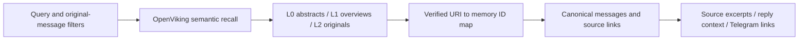

# Chat memory

The agent requires OpenViking. It exposes one read tool, `search_memory`, across
original messages, discussion extracts, summaries and facts. Every derived
record links to original messages, which remain directly retrievable. SQLite
preserves canonical evidence; it is not an alternate agent retrieval backend.



## Local data and coverage

Imported evidence and its matching manifest live at `MEMORY_PATH` and
`OPENVIKING_MANIFEST`, defaulting to `var/agent/evidence.sqlite3` and
`var/agent/import/manifest.json`. They are separate from the immutable source
snapshots under ignored `evals/datasets/` and generated run artifacts under
ignored `evals/runs/`. Local datasets and imports are not supplied by a fresh
clone. Preserve maintained summaries and facts when preparing another index.

| Table | Role |
| --- | --- |
| `messages` | Original text, sender, timestamp, reply target, conversation key and Telegram URL |
| `memories` | Records of kind `message`, `discussion`, `window`, `summary` or `fact` |
| `sources` | Links from records to original message IDs |
| `metadata` | Source provenance and historical coverage |
| `memory_fts` | Lexical index used by offline inspection and comparison commands |

Discussion extracts concatenate up to eight messages. Grouping uses a channel
post thread or reply chain, with 15-minute windows for unrelated messages. These
are navigation aids, not guaranteed topic boundaries. OpenViking additionally
generates summaries during import. Read the [import and retrieval guide](../../evals/suites/openviking/README.md)
before changing resource export, path reconciliation or semantic recall.

## Search contract

The domain exposes an async `MemoryBackend.search` interface. The agent's only
implementation is OpenViking:

```python
await memory.search(
    query="Who considered reusing Osinara for a bot with custom skills?",
    author_id=None,
    after=None,
    before=None,
    limit=3,
)
await memory.search(memory_id="message:15100")
```

Provide a semantic query or a returned memory ID. Query recall uses OpenViking's
`AsyncHTTPClient.find`, without a reranker or session query planning. All mapped
L0/L1/L2 records can enter recall, including original messages absent from
summaries. Direct memory-ID expansion reads canonical local evidence.

Author IDs and inclusive timezone-aware ISO bounds constrain original sources
before recall. A multi-source record qualifies only if every source satisfies
the filters. OpenViking's import timestamps do not replace Telegram send times.
The adapter checks returned URIs against the verified manifest or acknowledged
live-message revisions before expanding the corresponding SQLite record.
Directory URI aliases for `.abstract.md` and `.overview.md` resolve to the same
canonical supporting messages.

Each hit contains its kind, ID, excerpt, supporting messages, up to four related
context messages and discussion IDs that the same tool can expand. Context
includes reply parents up to two edges away and neighboring messages. It may
contain other authors and dates and is labeled separately. Original message
excerpts are capped at 1,200 characters with `truncated` and `excerpt_start`.
Telegram URLs always come from canonical messages.

Both the agent and offline baseline consider at most 100 ranked candidates and
return up to five hits, keeping one per conversation. This provides diversity,
not text deduplication; distinct useful messages within a conversation can be
suppressed. Top-k recall does not establish completeness or prove absence.
Questions about all activity over a period need a chronological scan or an
aggregation rather than this bounded retrieval.

## Startup and storage

`MEMORY_PATH` and `OPENVIKING_MANIFEST` select a matching local evidence index and
completed import. The manifest records the index SHA-256 and actual parser paths,
including wrapped Markdown files and split chunks. Every exported record must
have an original leaf. Startup rejects missing/mismatched files, an incomplete
import, an unavailable server or a missing remote corpus. There is no lexical
fallback or startup mode without memory.

`docker compose up -d --build --wait` starts both services. The agent waits for
OpenViking readiness, validates memory and its Telegram identity, and then polls.
The agent uses `http://openviking:1933`; host import tools use the published
loopback port. Evidence and the manifest are mounted read-only. The OpenViking
workspace, live-message database, group registry and logs persist separately on
the host.

Restart the agent after changing evidence or the manifest. Import into a fresh
namespace after index updates. Snapshot refreshes and deletion propagation are
not automatic. Historical content is untrusted source data. The imported corpus
and live messages are distinct from the agent's in-memory conversation history
and observed-group registry.

## Incoming group messages

Message capture runs before owner authorization for every delivered group or
supergroup message. It records all participants, even when Dashulya stays silent.
Edited-message updates use the same recorder without invoking a reply. Private
messages and service events are excluded. Text, captions and attachment type are
stored, along with chat, author, topic, original send time and reply target;
passive capture does not download or transcribe attachment contents. After owner
authorization and a positive addressing decision, the reply path can download the
current photo/image document and its direct reply parent's image into RAM. JPEG,
PNG and WebP signatures are checked, and their combined bytes are capped at
20,000,000 during streaming. An image known to exceed the remaining budget is
not downloaded and instead produces an explicit oversized-image note for the
reply agent. An overflow
discovered while streaming stops the download and produces the same note.
Native AG2 image inputs and omission notes accompany the question, labelled
with their source message IDs. Group inputs are restricted
to the selected reply context. No image bytes or generated descriptions are
written to the evidence database or indexed in OpenViking. Older group media
remain placeholders. Private images stay only in bounded in-memory history.

The same reply path accepts sticker messages and direct-reply stickers. Static
stickers use their image bytes; animated and video stickers use Telegram's
JPEG/WebP thumbnail, never the original TGS/WEBM animation. Native inputs label
thumbnails as previews with motion unavailable. An absent thumbnail produces a
specific omission note without a download; oversized originals/previews retain
the existing byte-budget omission. Regular, mask and custom-emoji sticker
objects use these same format rules. Capture still records only the attachment
type and original message evidence; no sticker image or description is indexed.

Telegram animations (GIF or silent MP4) and GIF documents use their static
thumbnail with an animation-preview label. The animation field takes precedence
over the duplicate document field Telegram may include for compatibility.
Missing/oversized thumbnails produce omission notes without downloading the
animation. The same path accepts current animations and direct reply parents;
passive capture and durable evidence remain unchanged.

Successfully delivered group responses are also recorded with their actual
Telegram message IDs, send times and reply targets; split responses produce one
record per delivered chunk. Rich responses retain their source Markdown when
Telegram does not return ordinary text. Incoming reply snapshots fill missing
parents without replacing a recorded original or its deeper reply relationship.
Private messages remain excluded.

The same local journal supplies immediate group reply context: the latest 20
messages up to the request in its chat/topic, plus reply ancestors up to five
hops, deduplicated and ordered. This direct read includes pending revisions and
does not wait for OpenViking. Each reply uses a fresh AG2 stream with this bot's
previous messages assigned the assistant role. See
[the reply-context ADR](../adr/0002-rebuild-group-reply-context.md).

`LIVE_MEMORY_PATH` defaults to `var/agent/memory.sqlite3`. Its `live_chats`
and `live_messages` tables preserve canonical originals separately from the
immutable imported index. The composite `(chat_id, message_id)` identity prevents
collisions between groups. Delivery duplicates are idempotent; edits increment
a revision, and older updates cannot overwrite newer content. The same row
contains a durable indexing queue via `revision`, `indexed_revision`, `attempts`
and `retry_at`. Capture commits locally before continuing to command routing.

An application-owned worker checks the queue every two seconds. Through the
official SDK, it upserts Markdown resources under
`viking://user/default/resources/telegram/chat_<id>_block_<message_id // 8>/<message_id>.md`.
These are resource documents, not personal-preference memories. Blocks contain
at most eight message IDs from one chat, bounding summary regeneration. They
are navigation aids, not inferred discussion boundaries. Each batch requests
semantic and vector processing with `wait=True`; indexing uses the models
configured on the OpenViking server. This adds model calls as messages arrive.

Successful publication acknowledges only the revision actually sent. Edits
arriving during indexing remain queued. Failures retry with exponential delay
up to 60 seconds; cancellation leaves unacknowledged revisions for the next
startup. Retrying uses replacement/upsert at the same URI, never content append.
If a previous attempt already wrote identical bytes, forced reindexing repairs
potentially incomplete summaries or vectors before acknowledgement.

The same `search_memory` query searches imported and live resources. Live IDs
are `telegram:<chat_id>:<message_id>` and `telegram-block:<chat_id>:<block>`.
Only current acknowledged revisions are eligible for semantic recall; direct
ID expansion reads the latest local original. Author/time source filters and
canonical Telegram links apply to live evidence too. Live coverage reports
message, chat, indexed and pending counts separately from the historical import.
As with the existing owner-only prototype, retrieval is not bound to the chat
where a question was asked; storage identities are chat-specific.

To receive ordinary group messages, grant the bot administrator status or disable
privacy mode through @BotFather and re-add it. Telegram excludes other bots'
messages even for administrators ([Telegram FAQ](https://core.telegram.org/bots/faq#what-messages-will-my-bot-get)).
Capture can only preserve updates Telegram delivers: it does
not fetch old history or restore updates lost during prolonged downtime, and
does not receive a general message-deletion stream. The immutable snapshot is
not rewritten when live edits arrive.

## Offline maintenance and comparison

SQLite indexing and lexical inspection remain available without model calls:

```sh
uv run python -m dashulya.memory --index evals/runs/fastnewsdev-next.sqlite3 build \
  evals/datasets/fastnewsdev/snapshot.sqlite3 --chat fastnewsdev_chat
uv run python -m dashulya.memory search "rtk pytest"
uv run python -m dashulya.memory expand "message:15100"
```

Builders refuse existing destinations. Preserve maintained records when
creating another index. Summary/fact writes require one to eight existing source
IDs; this enforces provenance integrity, not the semantic truth of the text:

```sh
uv run python -m dashulya.memory remember \
  "A participant considered reusing Osinara for a bot with custom writing-style skills instead of building a bot from scratch." \
  --sources 15100
```

The agent has no write tool. Re-export and import after maintenance before using
that changed index with OpenViking. Follow the [experiment guide](../../evals/suites/openviking/README.md)
for import and offline comparisons. The [memory ADR](../adr/0001-openviking-memory.md)
records the backend decision, measured pilot evidence and its limitations.
Reusable evaluation code is separate from the application package.
