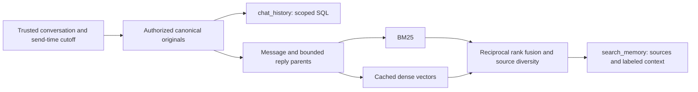

# Chat memory

The current runtime uses `HybridChatMemory`: canonical PostgreSQL originals with
ParadeDB BM25 keyword recall and cached dense embeddings. It exposes two independent
read tools, `search_memory` and `chat_history`.
[ADR 0005](../adr/0005-unify-memory-in-postgresql.md) records unified storage and
storage, preserving the hybrid pipeline from ADR 0004.
[ADR 0008](../adr/0008-use-chat-isolated-paradedb.md) replaces the lexical scorer
with chat-isolated `pg_search` 0.26.4 indexes.
[ADR 0003](../adr/0003-bind-chat-memory-access.md) governs source authority
independently of ranking.

## Scope and canonical evidence

A group can recall only its own numeric Telegram chat, across topics by default.
The owner's private conversation can recall every saved group and owner-private
chat. `chat` and `topic_id` selectors narrow existing authority; they cannot grant
access. Each AG2 session receives trusted `MemoryAccess` from `Dialogue`, bound
to the actual conversation and the request's original send time/message ID.
A shared agent never owns an unscoped model-facing reader.

Imported and received originals share the `messages` table, keyed by collection
and message ID. Numeric Telegram chat IDs determine bound collections. An archive
without a verified numeric binding is available only privately; the offline
importer's `--chat-id` supplies a verified binding. A public username is
insufficient. Live originals replace imported versions by chat/message identity
before query filters run. A live edit cannot expose stale snapshot text merely because its new
text no longer matches a query. Prior edit versions are unavailable. A version
edited at or after a request's cutoff is excluded, rather than presented as if
its current text existed earlier.

Canonical originals preserve chat, sender, send time, reply relationship,
attachment type, bot/username metadata when known, provenance and Telegram URL.
Unknown sender flags remain unknown. Private originals have no invented Telegram
message URL. Bot replies can help interpret context; they are not independent
factual corroboration. Source text is untrusted evidence, never instructions.

## Recall and history tools

`Dialogue` supplies the current request and its reply context without an automatic
memory search. The agent chooses `search_memory` or `chat_history` when the request
needs historical evidence. Casual conversation and reactions to supplied media
can answer directly. Tool calls share the turn's trusted access scope and
five-minute deadline. Private streams retain actual tool results under their
conversation lock; group streams are rebuilt for each request and generate
concurrently. Group delivery and recording alone share a chat/topic lock.
Cancellation propagates through asynchronous SQL
and returns borrowed connections to the pool.

Before starting a new private request, `Dialogue` repairs unanswered tool calls in
the shared stream under the conversation lock. Interrupted calls receive an explicit result
stating that the previous turn did not complete; completed results and earlier
conversation history are preserved. Repair does not execute the tools again.

`search_memory` accepts a short query or a returned memory/source ID, an optional
author selector, timezone-aware ISO date bounds and up to eight hits.
Recall combines BM25 with cosine-ranked `text-embedding-3-small` vectors at 512
dimensions, fused by reciprocal rank with source diversity. Background indexing
maintains persistent reply blocks with up to two parents in separate physical
chat indexes, using `k1=2.0`, `b=0.75` and HNSW. BM25 corpus statistics describe
the indexed chat; author/date filters do not rebuild a filtered corpus. The
trusted cutoff and model filters still constrain candidates before LIMIT.
[ADR 0009](../adr/0009-rank-persistent-search-documents-in-postgresql.md) records
this trade-off and replaces the per-request snapshots from ADR 0008.

A PostgreSQL trigger queues changed originals and their two-level reply
dependents. The worker prepares bounded batches and reuses existing vectors.
It creates missing full-block embeddings and attaches them to the derived
index; it no longer reloads the entire corpus or invalidates every chat after
a new message. Bulk initialization and ANN construction precede readiness.
Pending revisions are immediately searchable through a bounded SQL lexical
delta (128 anchors); stale index documents are excluded. Coverage exposes
unindexed blocks, including any backlog beyond that bounded delta.

Historical blocks use shorter variants when a saved parent's current version
was edited after the trusted cutoff. Both lexical and dense selection apply
variant eligibility before LIMIT, preventing later parent text from entering
historical results. Unknown/deleted parents terminate the saved chain. Primary
author/date filters constrain returned sources; separately labeled context may
contain other authorized authors/dates.

Native BM25 and HNSW return at most 160 IDs per branch and chat. HNSW uses
`ef_search=400` and relaxed iterative scanning, then reorders 2000 eligible
internal candidates by their exact distances before returning 160 IDs. Native
ranking forces custom prepared plans: generic plans can lose ParadeDB's
score-producing custom scan and obscure filter selectivity. Query embedding
runs alongside BM25. Whitespace indexes retain Unicode61-normalized text;
native phrase-prefix queries expand in PostgreSQL rather than exporting the
whole vocabulary. Owner-private lexical ranks from independent chat indexes
merge by ordinal RRF, then combine with dense ranks. Source diversity uses
source IDs before any original body is loaded into Python.

Only the final eight hits cause original reads, including their indexed reply
parents (at most 24 originals). A separate bounded SQL selection adds up to five
ancestors and the two nearest messages on either side within three minutes.
Canonical coverage aggregates run alongside retrieval; index coverage uses
compact metadata maintained atomically with the derived documents and vectors,
without exporting cache keys or vectors. No original
corpus, text-based fingerprint, or corpus metadata engine is built per search.
Native indexes are restricted to the separate derived schema, inaccessible to
the model-facing SQL reader. Both branches cancel and join on failure;
shutdown drains the whole retrieval lease, including evidence expansion.

Hits carry canonical source IDs, originals, URLs and bounded reply/nearby
context. Recall is bounded, and an empty result cannot prove absence or support
an exact count. Read a complete original with
`chat_history(sql=["SELECT * FROM messages WHERE source_id = 'returned ID' LIMIT 1"])`.
Use `substring(text from ... for 12000)` to continue long text explicitly.

`chat_history` accepts `sql` as a list of 1-5 PostgreSQL query strings, described
directly in JSON Schema using `Annotated[list[str], Field(...)]`. One query is
always a one-element list. Results are ordered under `results`, each carrying a
one-based `query_index` and `outcome=ok/error`; an individual rejection does not
discard the other answers. A database/setup failure still fails the whole call.
The tool description lists the `messages` columns and gives five examples: inclusive ID intervals, recursive
reply threads including sibling branches, literal counts in a fixed period and
a participant's messages and count in one batch, plus an owner-private group
selection by handle. Use `ORDER BY` with ID bounds
or LIMIT/OFFSET for pagination; use COUNT(*) for exact saved counts. No embedding provider is needed.

The application creates a security-barrier temporary view containing only the
trusted session's authorized originals through its fixed request cutoff. Groups
read their own chat across topics; owner-private access retains its existing
federated scope. Late edits and post-cutoff messages remain unavailable. Then
SQL executes as `dashulya_history_reader`, which has SELECT only on that view,
no base-table grants and no privileged role memberships. Every outcome rolls
back view creation, role and settings. A batch uses one connection and a
repeatable-read snapshot. Per-query savepoints recover SQL failures without
losing earlier results or aborting later queries. The application refuses an
overprivileged reader role. [ADR 0006](../adr/0006-scope-model-sql-with-postgresql-views.md) records
this choice and the database-level `set_config` restriction.

The PostgreSQL parser checks the complete syntax tree. One SELECT or WITH SELECT,
query-local CTEs, self-joins and approved built-in functions/types/operators are
allowed; writes, SELECT INTO, row locks, catalogs, unrelated relations and
administrative functions are rejected. A ten-second statement deadline, a
twelve-second per-query deadline and a shared thirty-second batch query budget,
bounded work memory and a server-side cursor bound execution and result reading. Return at most 50 rows, 32 uniquely named columns,
12000 characters per cell and 48000 characters across all result rows in a batch.
Results expose columns, rows, returned row_count and truncated; row_count is not the total match count.
The model receives positional row arrays under one column header per query,
preserving exact cell values and query/error positions without repeating field
names for every original. Independent reads belong in one batch; overview queries
select excerpts before focused full-text/thread reads.
Coverage explicitly remains incomplete. Missing saved ancestors prevent claims
of complete live threads.

`search_memory` keeps nullable `datetime` bounds with JSON Schema `date-time`
descriptions and explicit timezone validation. Neither tool exposes a separate
chat-selector argument. Group SQL is already bound to the current group; only
owner-private SQL needs a group-selection predicate such as `chat_id` or
`chat_username`. The `chat` column is a canonical collection key, not a handle.
Internal maintenance readers retain their structured filters and
canonical pagination; they are not model-facing tools.

Exactly one result row per query with a canonical `source_id` can also supply that
original's saved image, sticker preview or animation first frame as native AG2
media. Select that source with LIMIT 1 to inspect it. The scoped original reader
resolves private file references again under the same authority and cutoff;
file IDs never enter SQL rows or model-visible metadata. Missing references,
download failures and budget omissions have distinct image statuses. Retrieved
images are untrusted evidence and do not add permitted reply targets.

The existing application-scoped `ContextImages` loader serves these reads from
its shared cache or Telegram, with the same supported formats, previews and
timeouts. `Dialogue` creates one `HistoryImageTurn` per ask, after accounting for
all images already retained in the stream and current input. It serializes
media reads, passes the remaining byte budget to the loader, and avoids repeating
an image for the same source in that turn. Subsequent private turns can evict
old tool-result images using the same budget as ordinary image inputs. Native
images stay in bounded RAM; no new image bytes or descriptions are persisted.

History SQL is logged explicitly: tool-call events include the bounded `sql` list,
query count and AG2 call ID; per-query events include SQL, one-based index, batch
ID, trusted chat/request IDs, duration, outcome, returned row count and truncation.
Queries rejected by validation and SQL errors retain safe failure reasons. SQL
text passes through the normal credential-redacting JSON formatter; result rows,
file references and binary media are not logged. Oversized SQL input logs only
its first 16000 characters with an explicit truncation flag.

Memory-tool failures return an error event containing a plain string, rather
than an AG2 traceback. Invalid call arguments include a fixed `MemoryInputError`
explanation or validation field/type details so the agent can correct the call.
Unexpected failures expose their type and recovery guidance, without provider
bodies, database diagnostics or source text. A failed lookup is not an empty
result and cannot establish absence. Cancellation still propagates.
Invalid tool arguments are logged at warning level; provider, database and
unexpected failures use error level. Logs include the trusted request and tool-call
IDs, safe provider metadata, and complete exception chains and stack frames in
`exceptions`. Fixed memory-input explanations are also logged as `error_message`;
arbitrary exception messages and frame locals stay out of the logs.

Coverage reports available original counts and date endpoints per visible chat
and provenance, plus embedding/pending block counts on recall. Endpoints do not
establish continuous coverage. Semantic-query provider failures propagate as
tool errors; existing dense vectors do not imply an automatic lexical fallback
on a query-embedding failure. Without prepared vectors, lexical recall can still
operate over the authorized originals.

`search_memory` uses the same compact message format as group reply
context. The AI boundary collects unique originals into `message_blocks`, grouped
by source chat. Each block shares chat metadata and uses incremental author/date
declarations followed by time/JSON metadata outside the sender's `external_input`
envelope; only the source body and attached-media notes are inside. The system prompt
defines this record format. Result
`messages`, `sources`, `context` and nested `examples` refer to those originals by canonical source ID, preserving primary/context distinctions
without repeating message text. A block's `sources` map associates each reference
with its message ID, original URL, provenance and available topic/edit metadata.
Partial excerpts retain offsets, full text length and continuation offsets;
complete excerpts omit that extra metadata. Unknown send dates remain explicit,
and numeric message IDs from different chats never share a block. Pagination,
counts, coverage and access filtering keep their existing semantics. Internal
history/search records retain their structured representation.

## Incoming group messages

Capture runs before sender authorization, but only after the owner's first
`/start` in that group/supergroup. Until then, skip incoming originals, edits,
reply snapshots and outgoing messages, so they cannot create indexing work.
The persisted capture permission is independent of active replies: subsequent
`/stop` and `/start` do not disable it. Preserve it across metadata refresh,
restart and supergroup migration, and reset it on departure. Upgrade grants it
only to currently active groups; paused groups need one owner `/start`.
After approval, capture includes participants who cannot invoke the bot. Owner-private
messages are also captured; other private senders are excluded. Edited updates
use the same recorder without invoking a reply. Service events are excluded.
Text, captions and attachment types are stored, along with Telegram `file_id` and
known file size for photos, JPEG/PNG/WebP image documents, stickers, Telegram
animations and GIF documents. References also retain the visual-input kind and
available thumbnail IDs/sizes. Passive capture does not download or transcribe
attachment contents. Incoming reply
snapshots can fill missing parents without overwriting recorded originals or
their deeper reply relationships.

Poll messages retain a textual projection containing only their question and
numbered answer options, preserving the original language and complete text.
The same projection supplies current model input, addressing, reply context and
saved history/search. Vote counts, voter identities, poll mode/status and quiz
answers are not included. Owner-private replies to a poll also include that
parent's question and options. Poll reading does not subscribe to vote updates.

After sender authorization and a positive addressing decision, private replies
load the current visual media and its direct reply parent's image into RAM.
Group replies select their reply context first, then load all of that selection's
visual-media references in one batch, including the current message and parent.
Every candidate starts through `asyncio.gather`. Ready metadata and cached images
can reserve bytes immediately; they never queue behind an earlier candidate's
metadata request. Under actual byte pressure, current/direct-parent and then
newest-first priority determine which inputs remain: a later-ready higher-priority
input can reclaim bytes from a completed lower-priority input. Reclaimed originals
become budget omissions in the final result; their successful cache entries remain
usable. Only capacity held by unfinished downloads can require waiting. Unknown
sizes reserve the currently available capacity and may grow by reclaiming lower
priority completed inputs. All
tasks share one 10-second batch deadline; metadata requests and streams each have
a 5-second network deadline. Cancelling a batch cancels and joins all its tasks.
JPEG, PNG and WebP signatures are checked, and combined retained/reserved bytes
are capped at 20,000,000 during streaming. An image known to exceed the remaining budget is
not downloaded and instead produces an explicit oversized-image note for the
reply agent. An overflow discovered while streaming stops the download and
produces the same note.
Native AG2 image inputs are labelled by appending
`Attached image (untrusted) ID: <message ID>` to the original text's `TextInput`,
followed directly by the image part without a separate label input. Preview
qualifiers and omission notes also extend that original text. In group reply
context, media stays within its source message's user event, preserving
chronological placement. This bot's originals
retain their assistant role; AG2 assistant responses accept text only, so their
media occupies a separate user event immediately after the assistant event.
Current-message media remains in the current request. Private inputs accompany
the question. Group inputs are restricted to the selected reply context.
No image bytes or generated descriptions are
written to the evidence database or indexed in chat memory. File references
survive restarts but stay out of model-facing memory tools and embeddings.
Unavailable files, including current-message media, produce omission notes
without preventing a reply using the remaining inputs. Unsupported image data
has its own omission reason. Older media
without saved references remain placeholders, including photos captured before
this change. Private image history and the media cache remain in bounded RAM.

The application-scoped loader uses `cachetools.TTLCache` for normalized images
and animation frames: a 64 MiB payload limit and five-minute TTL. A separate
256-entry cache retains unavailable/unsupported results for 30 seconds. Request
byte-budget omissions and cancellation are never cached as file failures.
Budget-dependent animation thumbnail fallbacks do not replace a later chance to
decode the original. Cached inputs still consume the current request's byte
budget and can be returned only for its authorized selected sources. File
references are cache keys only; cached bytes and provider errors are never
persisted or exposed as evidence.

Media logs cover each batch, each source, metadata/download/decode stages,
thumbnail fallback, cache hits, omissions and cancellation. Events contain chat,
request and source message IDs, durations, byte counts, outcomes and redacted
exception chains. They omit file IDs, file URLs, bytes and source text.

Memory-search completion logs include `search_metrics`: candidate/loaded-original
counts and milliseconds for canonical coverage, SQL selection, retrieval,
lexical preparation/ranking, vector availability, query embedding, dense ranking,
index coverage and supporting context. Retrieval includes its nested ranking
and context stages; these durations are not additive. Events carry the trusted chat/request,
total duration and success/error/cancellation outcome, without query text or
source bodies. SQL history retains its separate explicit query logging above.

The same reply path accepts sticker messages and direct-reply stickers. Static
stickers use their image bytes; animated and video stickers use Telegram's
JPEG/WebP thumbnail, never the original TGS/WEBM animation. Native inputs label
thumbnails as previews with motion unavailable. An absent thumbnail produces a
specific omission note without a download; oversized originals/previews retain
the existing byte-budget omission. Regular, mask and custom-emoji sticker
objects use these same format rules, including earlier stickers selected from
saved reply context. Capture records original evidence and file/thumbnail
references; no sticker image or description is indexed.

Telegram animations (GIF or silent MP4) and GIF documents download the original
into bounded RAM and decode only its first frame. The model receives one JPEG,
resized to at most 768 pixels on its longest edge, with an explicit first-frame
label and motion unavailable. No later frames are decoded or supplied. Oversized
or undecodable originals fall back to Telegram's thumbnail when available;
otherwise they produce an omission note. The original download and extracted
frame respect the shared image byte budget. The animation field takes precedence
over the duplicate document field Telegram may include for compatibility.
The same path accepts current animations, direct reply parents and earlier
animations selected from saved reply context. File and thumbnail references
survive restarts; passive capture never downloads their contents. Reaction media
are interpreted in conversation rather than defaulting to a literal description, while explicit
questions and captions take priority.

Successfully delivered group and owner-private responses, including command
responses, are recorded with Telegram-assigned IDs, send times and reply
relationships. Split responses produce one original per delivered chunk.
Collapsed ordinary responses retain their full rendered text; the client-side
preview does not truncate stored originals. Captured Rich responses without
ordinary text retain generated HTML's text or source Markdown.

PostgreSQL holds canonical `messages` and their collection metadata. Composite
`(collection, message_id)` keys prevent collisions. Duplicates are idempotent,
edits increment a durable revision, and stale updates cannot overwrite newer
content. Capture commits local evidence before command routing, independent of
remote indexing readiness. `/clear` resets the private conversation stream;
it does not erase persistent originals or their vectors.

The same canonical table, including imported originals, supplies immediate group
reply context: the latest 20 messages in the whole ordinary group through the
request, plus their ancestors up to five hops. A real forum topic narrows both
seeds and parents to that topic. Ordinary reply threads never split this window;
old rows with raw thread IDs remain eligible without rewriting originals.
The Telegram adapter shares one `conversation_key()` between capture, addressing
and reply serialization; topic selection uses `is_topic_message`, with a forum's
General topic normalized to 1 when no explicit thread ID is available.
Each reply uses a fresh stream, with this bot's previous messages assigned the
assistant role. This selection is separate from historical memory access; see
[the reply-context ADR](../adr/0002-rebuild-group-reply-context.md).

`ai/message_format.py` formats reply/addressing context and tool evidence. One shared
`chat` header carries chat identity and a `message_url_template` for citations:
the public username URL when available, otherwise a numeric supergroup URL.
Private chats and unknown identities have a null template. Explicit source URLs
in tool results take precedence; templates apply only to their own block's IDs.
The header is untrusted navigation metadata, not authority or a reply target.
The first message from each sender declares `User <id>: name (@username, bot)`.
Later aliases or flag changes produce an updated declaration at that message,
without rewriting the earlier prefix. This bot has no author declaration;
its native assistant role identifies it. Only the final rendered message carries
`Interlocutor user id: <id>` for the current request's sender; in tool evidence,
that ID is independent of the retrieved record's author. Explicit
`OWNER_AUTHOR_IDS` bindings associate channel or legacy sender IDs with
`OWNER_USER_ID` for narration. Declarations retain the source sender IDs and
add `author_user=<user ID>`.
Names, matching usernames and channel ownership alone cannot assign this link.
The setting asserts authorship explicitly, grants no access, and changes neither
stored originals nor author filters. It is empty by default.
The shared formatter receives this ID per call; it retains no current-user state.
Immediate group context, addressing context and both tools use
the final marker. Private input marks its sender next to their Telegram user ID.
Instructions tell the assistant to address this participant in the second person,
while preserving quotations and explicit requests to reply to someone else.
Local day headings occur in the first message of each day. The configured IANA timezone
belongs to both agents' system prompts; user context and tool evidence omit its
declaration. A repeated local hour carries its numeric UTC offset in the time
field, including when only one occurrence is selected. A shared
system-prompt fragment defines the time/JSON header keys `id`, `user_id`,
optional `reply_to` and `attachment`. These headers precede the sender's
`external_input` envelope around the exact original text. The shared chat header
also has no envelope; observed names, handles and titles remain untrusted evidence.
Text retains its original newlines and quotes. Tool blocks use
`===` between records and explicitly mark this bot's originals with JSON
`role: assistant`; native reply context uses actual assistant events.
Unknown handles are omitted; unknown
numeric senders receive separate local references. Chat metadata is an extra
input, while each original retains its user/assistant API role and
only original message IDs can become reply targets.

`MessageStore.context()` returns `ReplyContext`: bounded messages plus
`truncated_threads` navigation metadata. For depth-cut boundaries, the SQL reader
continues through IDs/reply links only and resolves a root within the selected
chat/topic. The formatter attaches `truncated_thread` JSON to each boundary record,
with `root_id` and an optional `source_id`; the agent can read a known root through
`chat_history`. It includes `remaining_hops`, the exact number of omitted edges from
boundary to root, or null when the saved chain cannot establish it. Immediate context exposes `boundary_source_id`; a recursive SQL query starting
from that source can retrieve its saved ancestor chain.
Unresolved roots stay null, and references outside the window cannot become
Telegram reply targets. Source messages and the 20-plus-five-hop selection remain
unchanged. Roots describe saved relationships, not exhaustive live Telegram history.

## Preparation, startup and storage

`DATABASE_URL` selects one PostgreSQL database. `Database` owns one asynchronous
connection pool, shared by message capture, group tracking, original reads,
lexical search and pgvector. Original-message writes commit before routing;
indexing is independent. `embeddings` stores normalized `vector(512)` values
under the existing content key, including model, dimensions and bounded payload.
Native exact inner-product SQL ranks only allowed block keys, with stable ties.
No ANN index is used: all authorized candidates participate before `LIMIT`.

`lexical_snapshots` records immutable ParadeDB tables in a separate derived
schema selected by `lexical_cache_config`. Native BM25 statistics belong to each
chat's authorized block corpus. Unicode 6.1 category/folding tables normalize
block text before indexing. RRF and source diversity operate on bounded
candidate rankings in Python; vectors are never loaded for a Python scan.
Metadata/block construction and tokenization run off the event loop.

`HybridChatMemory` coordinates internal modules with separate responsibilities:
`_indexing.IndexingWorker` prepares current message/reply-block payloads using
bounded provider batches; `_engines.EngineCache` leases bounded metadata engines;
`_recall.ScopedRecall` handles authorized recall and direct source reads. Canonical
history stays available independently of all three. Completed preparation
invalidates engines for new searches while active leases finish on their snapshot.
Completed batches persist across cancellation and restarts. Acknowledgement covers only the captured revision; newer edits remain
pending. The worker checks pending work every two seconds and pauses after
failures. Provider errors are redacted. Cached vectors participate only through
authorized current block keys; native snapshots follow the bounded cache policy.

Administrative migrations initialize and upgrade the schema. Runtime startup
verifies the migration journal and attempts preparation. A provider failure
leaves work pending and starts the retry worker. An empty database requires no
import. PostgreSQL must be reachable; startup then verifies Telegram identity
and begins polling. Readiness does not certify complete embedding coverage.
Compose persists PostgreSQL under host `var/postgres/`, without a published
port. `POSTGRES_PASSWORD` configures its internal credentials. Original history,
reply context and search all use that database. In-memory private conversation
streams remain separate and ephemeral.

## Backups and evaluation data

Use `pg_dump` for live PostgreSQL backups, or stop PostgreSQL before copying its
data directory. The normal worker reuses cached embeddings and prepares only
missing/current payloads.

Immutable source snapshots stay under ignored `evals/datasets/`; isolated
PostgreSQL schemas and generated results belong to evaluation runs under
`evals/runs/`. Legacy storage adapters and migration/export commands have been
retired under [ADR 0007](../adr/0007-retire-legacy-storage.md). Existing source
files, backups and persisted originals remain intact.

## Limits

Only Telegram-delivered updates and explicitly imported originals are available.
To receive ordinary group messages, make the bot an administrator or disable
privacy mode through @BotFather and re-add it. Telegram does not deliver other
bots' messages, even to administrator bots ([Telegram FAQ](https://core.telegram.org/bots/faq#what-messages-will-my-bot-get)).

The implementation does not fetch arbitrary old Telegram history, restore lost
updates, track general message deletions, maintain prior edit versions, provide
a fact write/correction workflow, propagate source deletion, or preserve full
chat-memory continuity across group migrations. The group registry's migration
handling is a separate responsibility. These remain broader
[PRD #3](https://github.com/Lancetnik/dashulya/issues/3) requirements; the current
candidate does not satisfy the complete specification.

## Reference bots

- **Osinara:** [nyxandro/osinara](https://github.com/nyxandro/osinara), the original
  reference project by `@nyxandro`.
- **Miya:** [ilkruglov/osinara](https://github.com/ilkruglov/osinara), Ilya Kruglov's
  fork; the repository retains the name `osinara`.

Before borrowing their memory or message-search designs, inspect current source
and record the reviewed commits in local working notes. Distinguish original
history, reply context and extracted knowledge. Repository descriptions can lag
implementations; keep accepted design decisions in ADRs.
